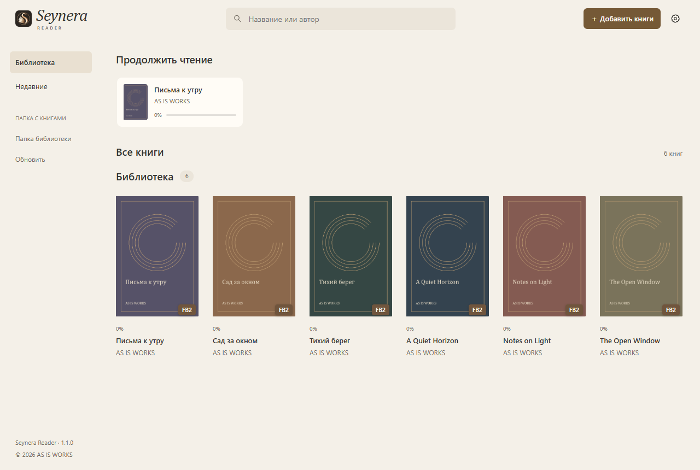
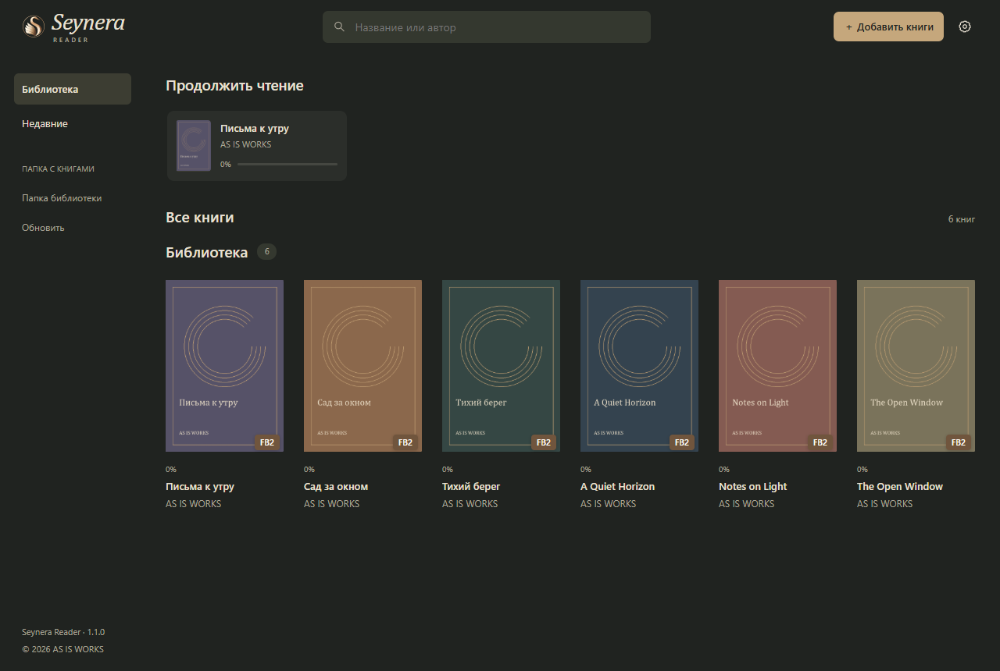
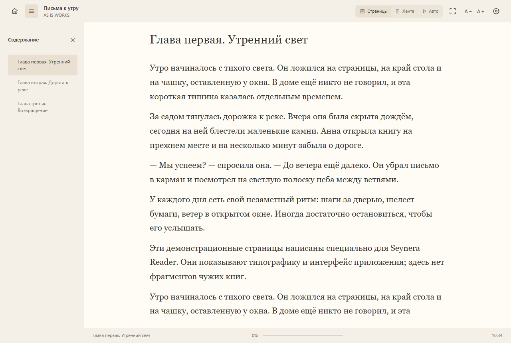
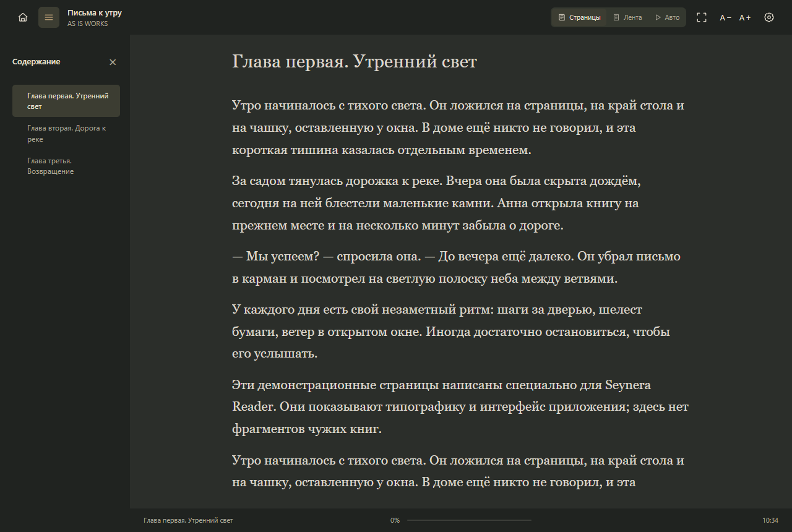
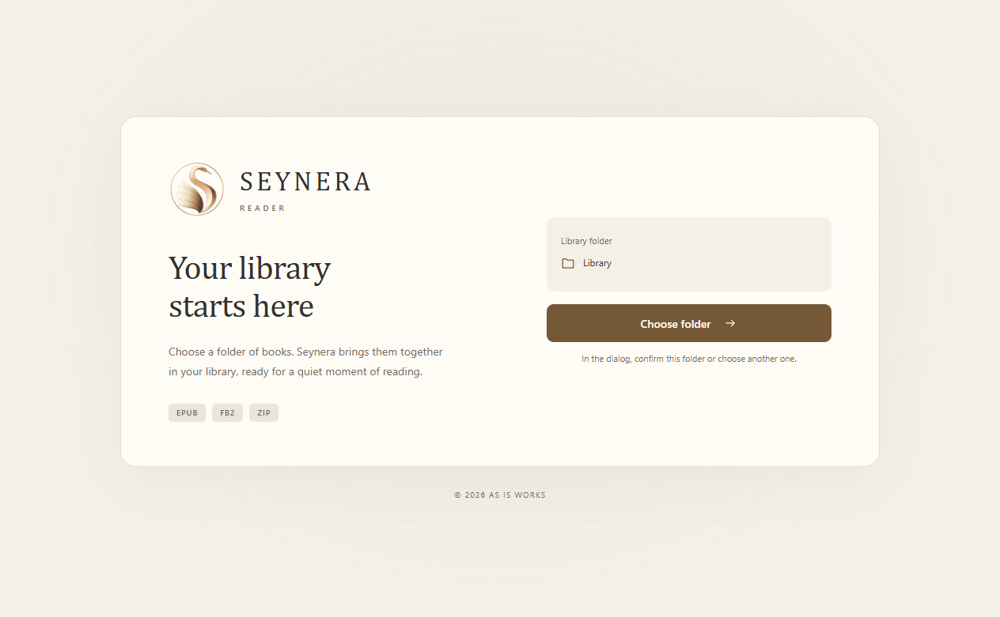

<div align="center">


**Ваше тихое место для чтения · A quiet place for your books**

EPUB · FB2 · ZIP &nbsp; | &nbsp; Windows 10 / 11 · x64 &nbsp; | &nbsp; RU / EN

### [↓ Скачать Seynera Reader 1.1.0 · Download for Windows](https://github.com/asisworks/Seynera-Reader/releases/download/v1.1.0/Seynera-Reader-1.1.0-Setup.exe)

[Русский](#русский) · [English](#english) · [Release 1.1.0](https://github.com/asisworks/Seynera-Reader/releases/tag/v1.1.0)

</div>

---

## Русский

**Seynera Reader** — персональная читалка электронных книг для Windows от **AS IS WORKS**. Спокойный современный интерфейс, тёплая светлая и мягкая графитовая темы, бронзовые акценты — чтобы внимание оставалось на книге.

### Возможности

- EPUB, FB2 и поддерживаемые ZIP с книгами, без ручной распаковки.
- Библиотека из вашей папки: обложки, поиск, вложенные папки и недавние книги.
- Лента «Продолжить чтение» и сохранение позиции после закрытия приложения.
- Режимы «Страницы» и «Лента», плавная автопрокрутка с регулируемой скоростью.
- Скрываемое оглавление, переходы по главам, внутренние ссылки и примечания, изображения.
- Настройки шрифта, размера, межстрочного интервала, ширины колонки и цветовой схемы чтения.
- Режим сосредоточенного чтения и интерфейс на русском или английском.
- Локальное хранение библиотеки и настроек: для чтения не нужен аккаунт.

### Установка

1. Скачайте **Seynera-Reader-1.1.0-Setup.exe** по ссылке выше или со страницы [Releases](https://github.com/asisworks/Seynera-Reader/releases/latest).
2. Запустите установщик, выберите язык и папку установки.
3. По желанию включите независимые галочки ярлыков рабочего стола и меню «Пуск».
4. При первом запуске выберите папку с книгами. Предлагаемую папку можно подтвердить в системном диалоге или выбрать другую.

**Требования:** Windows 10 или 11, процессор x64. Установщик — около 88,43 МиБ. Для программы, кэша и книг потребуется дополнительное место.

Настройки и служебные данные находятся в `Data` рядом с программой, библиотека по умолчанию — в `Library`. Выбирайте папку с правом записи для вашего пользователя. Произвольную внешнюю папку библиотеки можно подключить при первом запуске.

При удалении программы вопрос «Удалить пользовательские настройки?» по умолчанию предлагает **«Нет»**. Этот вариант сохраняет настройки, прогресс, каталог и историю; кэш очищается. При «Да» перечисленные настройки удаляются. Оригинальные книги и пользовательская `Library` не удаляются.

### Ограничения 1.1.0

PDF не поддерживается. Для книг с объёмом значимого текста более 3 млн символов требуется подтверждение, более 5 млн — открытие пока недоступно. Редкие нестандартные EPUB/FB2 могут отображаться иначе, чем у издателя.

Установщик пока не имеет цифровой подписи. Проверяйте источник загрузки и контрольную сумму; не отключайте защиту Windows.

## Скриншоты · Screenshots

| Светлая тема · Light | Тёмная тема · Dark |
| :---: | :---: |
|  |  |
|  |  |

<details>
<summary>Первый запуск · First launch</summary>



</details>

Скриншоты сделаны в версии 1.1.0. Книги и обложки в библиотеке — специально созданные демонстрационные материалы; они не входят в установщик.

---

## English

**Seynera Reader** is a personal ebook reader for Windows by **AS IS WORKS**. A calm, modern interface combines warm light and soft graphite themes with restrained bronze accents, keeping the focus on your book.

### Features

- Read EPUB, FB2 and supported book ZIP archives without extracting them manually.
- A folder-based library with covers, search, nested folders and recent books.
- Continue reading carousel and saved reading positions across application restarts.
- Page and Scroll modes, plus smooth auto-scrolling with adjustable speed.
- Hideable table of contents, chapter navigation, internal links, notes and images.
- Adjustable fonts, text size, line spacing, column width and reading color schemes.
- Focused reading mode and a Russian or English interface.
- Locally stored books and settings; no account required for reading.

### Installation

1. Download **Seynera-Reader-1.1.0-Setup.exe** using the link above or [Releases](https://github.com/asisworks/Seynera-Reader/releases/latest).
2. Run the installer, choose your language and installation folder.
3. Select desktop and Start menu shortcuts independently, if desired.
4. On first launch, choose your books folder. Confirm the suggested folder in the system dialog or select another one.

**Requirements:** Windows 10 or 11, x64 processor. The installer is approximately 88.43 MiB. Additional space is required for the application, cache and books.

Settings and service data live in `Data` alongside the application; the default books folder is `Library`. Choose an installation folder your Windows user can write to. You may connect an external library folder on first launch.

During uninstallation, **No** is the default answer to “Remove user settings?”. It preserves settings, reading progress, the catalogue and recent history while clearing the cache. **Yes** removes those settings. Original books and your `Library` are preserved in either case.

### Current limitations

PDF is not supported. Books exceeding 3 million significant text characters require confirmation; books exceeding 5 million cannot yet be opened. Unusual EPUB/FB2 files may render differently from their publisher's layout.

The installer is not digitally signed yet. Verify the download source and checksum; do not disable Windows protection.

Screenshots show version 1.1.0 with original demonstration books and covers. These sample books are not included in the installer.

## Проверка загрузки · Verify your download

**Version:** 1.1.0 · **Platform:** Windows x64 · **Size:** 92,729,326 bytes

**SHA-256**

```text
1F2547BFAEE2679472CBCE320AB3F6F300D9335A1BAE6AB1CFB69CC67A136D46
```

PowerShell:

```powershell
Get-FileHash .\Seynera-Reader-1.1.0-Setup.exe -Algorithm SHA256
```

Этот репозиторий содержит презентационные материалы и готовые выпуски. Исходный код приложения здесь не распространяется.

This repository hosts product information and ready-to-install releases. Application source code is not distributed here.

<div align="center">

**© 2026 AS IS WORKS**

</div>
